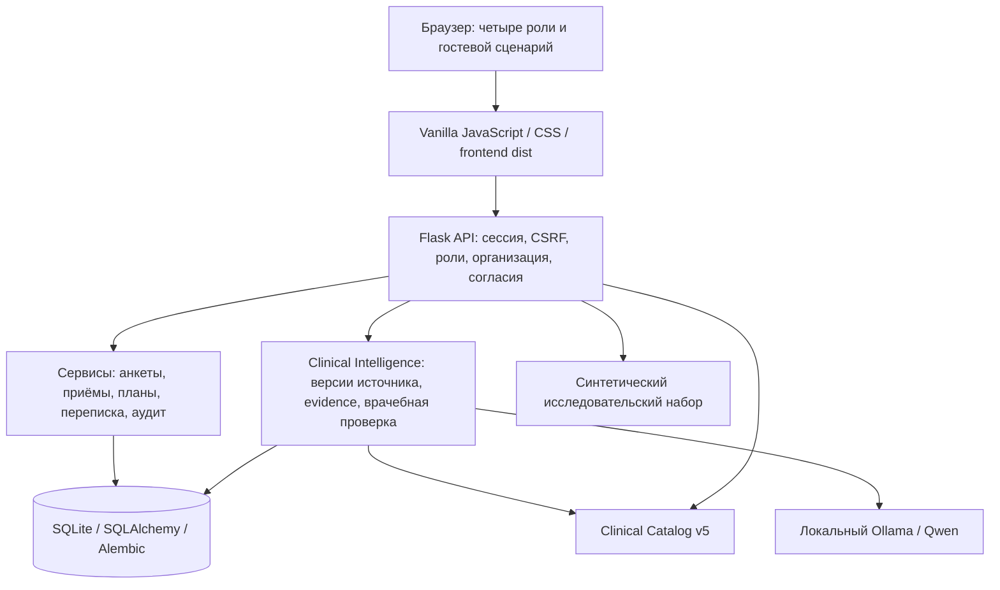

# Clinical Compass

**Clinical Compass связывает пациента, врача, клинику и исследователя в одном прототипе:** от первого опросника и обращения — до врачебной записи, опубликованного плана и обратной связи пациента. Clinical Intelligence помогает врачу разбирать текст обращения с помощью локального Qwen и проверяемых цитат; клинические решения остаются за специалистом.

Состояние на **28 октября 2026 года**: воспроизводимый учебный прототип для показа жюри, с реальными API, постоянной SQLite-базой, новым интерфейсом и проверенным запуском на Mac и в Docker. Это не клинически валидированная медицинская система. Показ и проверки используют синтетические данные.

## Возможности

| Роль / раздел | Что работает в прототипе | Границы текущей версии |
|---|---|---|
| Гость и новый пациент | PHQ-9, PHQ-2, GAD-7, GAD-2; предварительная сумма; регистрация или вход с переносом результата; история после перезагрузки и повторного входа | Гостевой результат хранится только в текущей вкладке и считается несохранённым до подтверждения сервера. Русские формы — неутверждённые учебные версии, без диагностической интерпретации |
| Пациент | Самочувствие и заметки, динамика, опросники, обращения, опубликованный план, отметки выполнения, переписка, запись на приём, профиль и фото, управление согласиями | Отметка выполнения — самоотчёт; полный календарь пропусков пока не реализован. Личный дневник и AI-чат не раскрываются врачу автоматически |
| Врач | Связи и приглашения, карточка пациента, анамнез, динамика, назначения опросников, обращения и приёмы, редактируемый черновик, отдельные подпись и публикация, учебные планы, направления, сообщения, рассмотрение событий и сигналов | Доступ зависит от организации, действующей связи и категорий согласия. Сигнал не означает установленный риск или экстренное реагирование |
| Clinical Intelligence / Qwen | Реальное извлечение NLP-тегов и точных цитат, предложения заполнения карты, ручная проверка, контекстный AI-чат и ссылки на клинический справочник | Экспериментальные функции требуют валидации и врачебного контроля; нет автоматического диагноза, назначения, подписи или публикации. Учебные иллюстрации Copilot/NLP Lab отдельно обозначены |
| Администратор клиники | Сотрудники с доступными именами, записи, организационные сведения, отдельное согласие на передачу ФИО пациента и его отзыв | Медицинская карта и личный дневник не входят в административную проекцию. OIDC/MFA, профессиональное подключение и часть организационных операций требуют дальнейшей настройки |
| Исследователь | Отдельный синтетический набор, группы A/B, число наблюдений и пропусков, среднее, методика, выгрузка агрегированного CSV | В рабочем учебном потоке нет графика. CSV выгружает общий агрегат, а не выбранную группу. Ряд наборов и конструктор когорт требуют отдельных study grants; импорт и расширенная аналитика частичны |
| Clinical Catalog v5 | **242 записи:** 77 препаратов, 77 диагнозов, 58 методов терапии, 30 инструментов; поиск, страницы, исходные поля и внутренние связи | 77 лекарственных записей включают 69 сводных карточек и 8 оригинальных инструкций. Карточка справочника не является назначением; права, источники и клинический выпуск проверяются отдельно |

Врач может ввести точный код диагноза в записи приёма: при **F41.1** интерфейс показывает **Авиандр** и другие точные совпадения из исходных инструкций. После сохранения диагноза они доступны в разделе «Лечение». Кнопка выбора переносит название и версию справочника в форму черновика; дозу/режим, сохранение, подпись и публикацию врач определяет отдельно. Это справочное сопоставление, без обращения к LLM. [Проверка сценария](reports/phase2/DIAGNOSIS_MEDICATION_20261028.md).

Карта сценариев: **`/#/demo/journeys`**. В текущей матрице — **102 маршрута и 249 API-операций**; это инвентаризация, а не утверждение о полной проверке каждого действия. Подробный статус функций: [FEATURE_PARITY.csv](reports/phase2/FEATURE_PARITY.csv), [INTEGRATION_MATRIX.csv](frontend/INTEGRATION_MATRIX.csv).

## Архитектура

Приложение сохраняет Flask-бэкенд и vanilla JavaScript-фронтенд. Готовые файлы нового интерфейса находятся в `frontend/dist`; отдельный frontend-dev-server для демонстрации не нужен. Навигация использует hash-маршруты `/#/...`, действия выполняются через JSON API `/api/v1/...`.



### Компоненты и хранение

- **API и бизнес-логика:** Python 3.11, Flask, SQLAlchemy, Alembic. Маршруты и сервисы находятся в `backend/cc_api`; NLP-провайдеры — в `backend/cc_nlp`.
- **Данные:** отдельная SQLite-база каждого evaluation workspace, WAL, foreign keys и `busy_timeout=20s`. Миграции применяются при инициализации; существующая база не сбрасывается. Неверсионированная legacy-база отвергается вместо автоматической перезаписи. PostgreSQL-профиль предусмотрен кодом, но не прошёл приёмку в этом окружении.
- **Авторизация:** обычные учётные записи и сессии; серверные проверки роли, организации, ACL источника и согласий. Изменения защищены CSRF. Критические операции дополнительно используют версии, идемпотентность и аудит.
- **Clinical Intelligence:** выбранный разрешённый источник → локальная модель → проверяемые цитаты и предложения → решение врача. Снимок NLP временный, около пяти минут; сохранённые отзывы и документы долговечны. Дневник пациента имеет отдельные правила приватности.
- **Клинические документы:** черновик → редактирование → подпись → публикация. Пациент видит опубликованное; изменение состояния выполняется отдельными действиями врача.
- **Сигналы:** правила и события отделены от AI-гипотез; предусмотрены журналирование, outbox и явное рассмотрение. Получение/подтверждение локального тестового события не доказывает оказание помощи.
- **Модель:** `qwen3:4b-instruct` через Ollama. Проверенный digest: `0edcdef34593eac1aa2be9c7d06c432dcf81945adca5eca2f27662c18f168ba0`. Веса не входят в исходный архив или Docker-образ. При недоступности модели диагностический ответ/допустимый fallback не считается успешной генерацией Qwen.

### Docker на Apple Silicon

В проверенной конфигурации веб-приложение работает в Linux/arm64-контейнере, а Ollama использует GPU/Metal на Mac. Сервис Compose с именем `ollama` в основном `compose.yaml` — **ограниченный мост к host Ollama**, а не отдельная модель внутри контейнера. Он разделяет сетевое пространство с приложением, сохраняя loopback-контракт NLP-провайдера.

На хост публикуется только `127.0.0.1:<порт>`. Мост ограничивает upstream и допустимые пути, не следует редиректам и не использует прокси. Ollama не требуется открывать на всех сетевых интерфейсах. Подробности: [security review](docs/phase04/DOCKER_LOCAL_MODEL_SECURITY_REVIEW.md).

Runtime: Gunicorn, **1 worker / 4 threads**, пользователь `10001:10001`; приложение ограничено **2 CPU / 1 GiB**, мост — 1 CPU / 512 MiB. База и стабильные ключи находятся в отдельном volume. Контейнер не зависит от host Conda. Образы и зависимости закреплены в `Dockerfile` и `docker/requirements.lock`.

`compose.cpu.yaml` сохраняет отдельный CPU-sidecar, но в проведённой проверке его реальный inference превысил 180 секунд. **Этот вариант не принят как рабочий AI-режим для показа.**

## Структура репозитория

```text
backend/cc_api/          API, модели, сервисы, роли и согласия
backend/cc_nlp/          NLP и локальные провайдеры
frontend/dist/          текущий интерфейс и маршруты
frontend/tests/         frontend-контракты без установки npm-зависимостей
clinical_catalog_data/  Clinical Catalog v5 и исходные материалы
research_data/          синтетические исследовательские данные
migrations/             Alembic-миграции
contracts/              контракты и схемы
scripts/                запуск, проверки, упаковка, запись видео
tests/                  исходные unit/contract-тесты
tests_e2e/              реальные Flask/SQLite/Chromium-сценарии
tests_perf/             измерения и изолированный стресс-тест
docker/                 WSGI, health checks, мост к Ollama, lock-файл
docs/phase04/           инструкции, архитектурные решения, runbooks
reports/                результаты, ограничения и сырые метрики
.agent/                 текущий план и контрольная точка
```

`deliverables/` — локальные готовые архивы и видео, обычно исключённые из Git. Частный runtime workspace всегда находится **вне репозитория**: SQLite, session secret, encryption key и учётные данные не относятся к исходному коду.

## Запуск на текущем Mac

Проверенная среда: macOS Apple Silicon, 16 GiB RAM, существующий Conda `cc-m1`, Python 3.11 и Node 22. Пересоздавать или обновлять её для запуска не нужно. Установка на новой машине и иные ОС требуют отдельной проверки.

1. Активируйте существующее окружение и выберите отдельный рабочий каталог:

```bash
conda activate cc-m1
export CC_CONDA_ENV=cc-m1
export CC_PYTHON="$(command -v python)"
export CC_DEMO_WS="$HOME/Library/Application Support/ClinicalCompass-Demo"
mkdir -p "$CC_DEMO_WS"
chmod 700 "$CC_DEMO_WS"
```

2. Запустите установленный Ollama на loopback и проверьте модель:

```bash
ollama list
# Только если нужная модель отсутствует:
# ollama pull qwen3:4b-instruct
"$CC_PYTHON" docker/warm_native_model.py
bash scripts/evaluation.sh check --workspace "$CC_DEMO_WS"
```

3. Создайте обычные учебные аккаунты. Команды интерактивно запросят выбранные вами пароли; повторно создавать существующие аккаунты не нужно:

```bash
bash scripts/evaluation.sh doctor --workspace "$CC_DEMO_WS" --email doctor@evaluation.test
bash scripts/evaluation.sh account --workspace "$CC_DEMO_WS" --role researcher --email researcher@evaluation.test
bash scripts/evaluation.sh account --workspace "$CC_DEMO_WS" --role clinic_admin --email clinic@evaluation.test
# Необязательный name-only шаблон для отдельного согласия пациента:
bash scripts/evaluation.sh privacy-setup --workspace "$CC_DEMO_WS"
bash scripts/evaluation.sh serve --workspace "$CC_DEMO_WS" --port 8766
```

Откройте **http://127.0.0.1:8766/#/demo/journeys**. Пациент регистрируется через UI; врач создаёт адресное приглашение, пациент проверяет категории и явно принимает согласие. Для разных ролей используйте отдельные профили/контексты браузера. Обычные вкладки разделяют cookies; cookies localhost также не разделяются по портам.

Остановка: Ctrl+C. Повторный `serve` с **тем же workspace** продолжает работу с сохранённой базой и ключами. Для отдельного QA выберите новый путь; не удаляйте рабочий каталог ради повторного запуска. Пошаговый показ: [JURY_RUNBOOK.md](docs/phase04/JURY_RUNBOOK.md).

## Запуск Docker

На проверенном Mac должны работать Docker Desktop и host Ollama с указанной моделью:

```bash
python docker/warm_native_model.py
export CC_JURY_PORT=8768
docker compose -p clinical-compass-jury config --quiet
docker compose -p clinical-compass-jury up --build -d
docker compose -p clinical-compass-jury ps
docker compose -p clinical-compass-jury exec -T app python docker/modelcheck.py
```

Первичная подготовка обычных синтетических ролей для отдельного demo-volume:

```bash
docker compose -p clinical-compass-jury exec -T app python tests_e2e/prepare_actors.py --workspace /workspace
docker compose -p clinical-compass-jury exec -T app python -m cc_api.evaluation_launcher privacy-setup --workspace /workspace
docker compose -p clinical-compass-jury restart app
```

Сгенерированные учётные данные остаются в приватном `/workspace/jury-actors.json` внутри volume; их не следует помещать в исходный код. Инструкция приватного доступа к ним и ручного создания аккаунтов: [DOCKER_JURY_RUNBOOK.md](docs/phase04/DOCKER_JURY_RUNBOOK.md).

Откройте **http://127.0.0.1:8768/#/demo/journeys**. Сохраняйте имя Compose-проекта при повторном запуске: оно определяет volume. `docker compose -p clinical-compass-jury down` сохраняет данные; **`down -v` удаляет volume** и не является обычной остановкой. Сброс должен быть отдельным намеренным действием.

Web health: `/api/v1/health`. Успешный health/build не доказывает готовность модели: для неё отдельно выполняется `modelcheck.py` и реальный пользовательский AI-сценарий.

## Проверки и измерения

Разделяйте исходные контракты, реальные E2E и нагрузку:

```bash
# Проверки существующего проекта; подробный состав — в самом скрипте:
CC_CONDA_ENV=cc-m1 bash scripts/validate_full.sh --browser
# Frontend-контракты; это не реальная проверка Flask/Ollama:
cd frontend
npm test
```

Реальные E2E требуют отдельного подготовленного синтетического workspace и запущенного сервера. Команды и проверенные условия: [native runbook](docs/phase04/JURY_DEMO_RUNBOOK.md), [Docker runbook](docs/phase04/DOCKER_JURY_RUNBOOK.md), [итоговая готовность](reports/FINAL_JURY_READINESS.md). Не направляйте тесты, создающие данные, в личную или общую базу.

До стресс-теста были выполнены 126 отдельных native и 126 Docker E2E, реальный Qwen, проверки всех 77 лекарственных карточек, ролей/согласий и сохранности после перезапуска. Это доказательство указанного набора сценариев, а не всех 1883 действий или клинической валидности.

Небольшие прежние измерения: [native performance](reports/phase1/PERFORMANCE_REPORT.md), [native load](reports/phase1/LOAD_REPORT.md), [Docker performance](reports/phase3/PERFORMANCE_REPORT.md). Они ограничивались 2 RPS и не определяли предел мощности.

**Стресс-тест от 28 октября:** [отчёт и точные команды](reports/stress/20261028/STRESS_TEST_REPORT.md), [промежуточные результаты](reports/stress/20261028/PROGRESS.md). Он использует отдельный `ccstress*` Compose-проект и volume: ступенчатые чтения без RPS-паузы, конкурентные записи, реальный Qwen с проверкой отказа при занятости, восстановление и сохранность SQLite. Результат: с постоянными HTTP-соединениями24 263 операции без ошибок, до160 read-worker и40 mixed-worker; при160 p95=3.33с. С новыми соединениями81 транспортный отказ; причина не установлена. Все622+1310 подтверждённых записей сохранены после restart. **В новом AI-прогоне успешных inference0/3: timeout/HTTP failure с явным fallback; перед живым AI-показом нужна диагностика и успешная повторная проверка.** Достигнутая нагрузка не выдаётся за универсальное число пользователей.

## Готовность, видео и ограничения

Проверенный статус — **готовность к локальному учебному показу с раскрытыми ограничениями**. Публичное клиническое применение, реальные профессиональные полномочия, OIDC/MFA, PostgreSQL, расширенный импорт/исследования и клиническая валидация остаются отдельными задачами. Функции не отключались ради демонстрации или скорости.

- [Итог готовности жюри](reports/FINAL_JURY_READINESS.md)
- [Acceptance checklist](docs/phase04/JURY_RELEASE_ACCEPTANCE.md)
- [Сценарий живого показа](docs/phase04/JURY_RUNBOOK.md)
- [Передача видео](docs/final_demo/JURY_VIDEO_HANDOFF.md): полный ролик 8:47.63, короткий 2:49.67 и семь глав; видеофайлы доступны в локальном пакете, не обязательно в Git-клоне
- [Политика и границы evaluation](EVALUATION_POLICY_ADDENDUM.md)

В видео по прямому разрешению владельца открыто показаны синтетические учебные QR, приглашения, логины и пароли. Это отдельный демонстрационный материал; runtime-файлы авторизации, cookies, ключи и базы в исходный пакет не входят. Обычные серверные проверки согласий сохраняются.

Исходный release-архив формируется по allowlist и проверяется checksum-манифестом. Он исключает БД/WAL/SHM, `.env`, секреты, модели, профили браузера и приватные QA-данные. Прежние отчёты сохраняют свою дату и область проверки; новая редакция README не превращает исторический результат в повторный тест текущей сборки.
