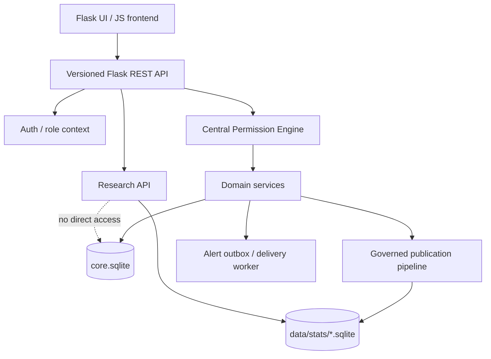

# Backend: архитектура, технологический стек, масштабирование

**Статус:** [СОГЛАСОВАНО] общая SQLite-база, Flask-интеграция, независимые stats-БД, модульность, динамические поля; [ПРОЕКТНОЕ ПРЕДЛОЖЕНИЕ] конкретная организация кода и технологические детали. Это **спецификация**, не описание уже существующего репозитория.

## Главная архитектурная идея

**Модульный монолит на Flask с гибридной моделью данных:** общая нормализованная клиническая БД + реестр динамических полей и значений + отдельное изолированное исследовательское хранилище SQLite.



## Почему именно так

| Компонент | Причина на текущем этапе | Ограничение/путь роста |
|---|---|---|
| Flask + Blueprints | Простая интеграция с проектируемым Flask-фронтендом и независимыми модулями | Для сложных процессов выделять фоновые службы и отдельный API слой |
| SQLAlchemy 2.x | ORM, связи, миграционная независимость от SQLite | Проверить запросы/типы при переходе на PostgreSQL |
| SQLite | Минимальная инфраструктура, удобство локальной разработки, демо, переносимость | Единственный writer в конкретный момент; ограничения высоких нагрузок и многосерверной записи |
| Alembic | Воспроизводимые версии схемы, работа команды | Учесть ограничения SQLite DDL и batch migrations |
| Pydantic/Marshmallow | Централизованная валидация запросов и ответов | Проверки прав не заменяются схемами |
| pytest | Права доступа и регрессии как исполняемый контракт | Необходимы интеграционные и негативные тесты |
| Отдельные stats SQLite | Ограничение исследовательского периметра, отдельные наборы данных | Публикация/отзыв и обезличивание требуют самостоятельного процесса |

## Слои

1. `api/routes`: транспорт, входная валидация, единые ошибки, сериализация.
2. `auth/context`: текущий пользователь, активная роль/организация и сеанс.
3. `permissions/policy`: централизованные проверки для объектов, полей и операций; **default deny**.
4. `services`: бизнес-операции, транзакции, проверки согласий, регистрации, выдача прав.
5. `repositories/models`: SQLAlchemy таблицы, запросы и индексы.
6. `events/outbox`: доставка предупреждений, идемпотентность, журналирование результатов.
7. `research`: отдельный pipeline публикации и строго разрешённые read-only запросы к наборам.

## Структура репозитория (предложение)

```text
backend/
  app/
    __init__.py          # create_app()
    config.py
    extensions.py
    auth/
    users/
    organizations/
    licensing/
    invitations/
    patients/
    doctors/
    permissions/
    field_registry/
    clinical/
    questionnaires/
    alerts/
    appointments/
    consent/
    research/
    security/
    audit/
    api/
  migrations/
  tests/
  scripts/
  data/stats/
  .env.example
  requirements.txt
  README.md
  run.py
```

## Ключевые решения [СОГЛАСОВАНО]

- **Одна** `core.sqlite` для пользователей, пациентов, врачей, организаций, связей, разрешений и клинических записей.
- Клиники — организационные контексты, а **не отдельные независимые медицинские карты**.
- Врач может работать одновременно в нескольких клиниках; пациент наблюдаться у врачей нескольких клиник.
- Ключи приглашения создают отношения `врач ↔ клиника` или `пациент ↔ врач` (с клиническим контекстом), в т.ч. для существующих профилей.
- Квота врачебных мест определяется договором, проверяется транзакционно и не жёстко задаётся числом «30».
- Доступ к информации определяется шаблонами в БД плюс индивидуальными разрешениями пациента.
- Роль администратора клиники не получает автоматический доступ к медицинским данным; даже ФИО/контакты — опциональные разрешения по пациенту/клинике.
- Researcher работает с отдельными опубликованными обезличенными/псевдонимизированными в рамках правомерных программ наборами, а не исходной клинической БД.

## Хранение и транзакции

- `PRAGMA foreign_keys=ON` на **каждом** подключении.
- `WAL`, `busy_timeout`, короткие транзакции, продуманные индексы по FK, времени и активным связям.
- Не выполнять сетевую доставку сообщений внутри транзакции с клиническими данными: фиксировать событие в `outbox`, доставлять отдельно.
- Избегать `ATTACH DATABASE` как способа обойти границу research/core; не полагаться на межбазовые FK/атомарность нескольких файлов.
- Для backup использовать согласованный механизм резервного копирования SQLite, регулярно **проверять восстановление**, не копировать активно изменяемую `.sqlite` без корректной процедуры.
- Для чувствительных данных нужен отдельный модуль шифрования и управление ключами **вне** БД; SQLite сам по себе не обеспечивает шифрование столбцов или разграничение ролей на уровне файла.

## Как масштабировать по мере развития

**Этап MVP:** монолит Flask + SQLite, один сервер приложения/корректный SQLite deployment, раздельные сервисы внутри кода, синтетические данные, базовые тесты.

**Следующий этап:** очереди/воркеры, полноценные уведомления и delivery receipts, статические файловые объекты отдельно, наблюдаемость, мониторинг производительности, индексирование сложных временных рядов, read-model для графиков.

**При росте нагрузки:** перевод core на PostgreSQL через SQLAlchemy/Alembic, не через «перенос файла»; тестирование миграций, блокировок и последовательностей. Research datasets могут оставаться отдельными файловыми наборами либо перейти в специально управляемое аналитическое хранилище.

**При внедрении в клиниках:** инфраструктурная изоляция и ключи шифрования, регламенты доступа, журналирование, резервное копирование, защищённые каналы, соглашения с организациями, юридическая оценка применимого законодательства РФ и требований к медицинскому ПО. Архитектура сама по себе не означает соответствие этим требованиям.

## Границы: что недопустимо

- Проверять права только в UI или отдельных `GET` маршрутах.
- Возвращать ORM-объект пациента без фильтрации разрешённых полей.
- Давать admin/researcher универсальный SQL-доступ к `core.sqlite`.
- При увольнении врача перезаписывать автора прежних записей.
- Автоматически расширять действующие права после изменения шаблона.
- Путать шифрование с хешированием или удаление идентификаторов с анонимизацией.
