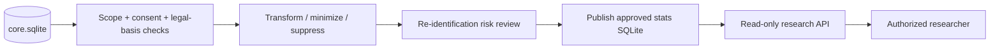

# Исследовательская аналитика, конфиденциальность и безопасность

**Статус:** отдельное хранилище stats, управляемая выдача доступа и необходимость согласий [СОГЛАСОВАНО]. Алгоритмы публикации, технические меры и правовая модель [ПРОЕКТНОЕ ПРЕДЛОЖЕНИЕ] и требуют специальной проверки.

## Исследовательский поток данных

Исследователь фармкомпании может получить, например, динамику состояния на фоне конкретного препарата с утверждённым набором атрибутов и сроков. Исследователь **не получает** исходную карточку пациента или возможность выполнить произвольный SQL по core.

## Три режима, которые нельзя смешивать

| Режим | Что происходит | Можно ли восстановить исходную личность? |
|---|---|---|
| Хеш | Одностороннее преобразование для проверки, в т.ч. стойкий password hash | **Нет**; слабые/малые исходные пространства могут угадываться, просто SHA-256 ФИО/телефона не является безопасной анонимизацией |
| Шифрование | Данные закрыты ключом (например, authenticated encryption), ключ хранится отдельно | **Да** у уполномоченного субъекта с ключом |
| Псевдонимизация | Идентификаторы заменены токенами; таблица соответствий защищена отдельно | **Да** при доступе к соответствию; данные остаются потенциально персональными |
| Анонимизация | Убраны/обобщены прямые и косвенные идентификаторы, проверен риск восстановления | Не должна допускать разумно осуществимой повторной идентификации; гарантия требует оценки контекста |

**Требование пользователя «хэшировать, затем восстанавливать» реализуется не через хеш:** необходимы шифрование или управляемая псевдонимизация. Обратимые данные нельзя автоматически называть анонимными.

## Governance публикации

1. Уполномоченный инициатор (администратор / настроенное автоматическое правило) создаёт `publication_job`.
2. Проверяется цель, объём, период обработки, условия договора организации и релевантные правовые основания/согласия пациентов.
3. Формируется минимальная исходная выборка; фильтр доступа применяется **до** экспорта.
4. Обрабатываются прямые идентификаторы и квазиидентификаторы: редкие диагнозы, даты, комбинации параметров, свободный текст, малочисленные группы.
5. Проводится проверка риска повторной идентификации, отдельно для единичных кейсов и агрегатов.
6. Только после утверждения создаётся опубликованный snapshot с `dataset_id`, schema version, scope, metadata, checksum, owner, expiration и журналом публикации.
7. Researcher получает индивидуальный read-only grant к dataset или разрешённой части.
8. Действует политика изменения/отзыва и истечения разрешений, при необходимости обновления опубликованных наборов.

**Нельзя** считать согласие клиники универсальной заменой правовым основаниям обработки данных конкретных пациентов. Возможность правомерно использовать данные без конкретной формы согласия зависит от применимого режима и требует юридической оценки; техническая модель должна хранить проверяемые основания и версии документов.

## Принципы минимизации данных

- Researcher получает только заранее утверждённые показатели/временные интервалы/когорты.
- Сырые сообщения, дневники, чат-бот, свободный текст и идентифицирующие поля исключать по умолчанию.
- Контактные данные и таблицы соответствий не копировать в `data/stats/`.
- Фильтры и группировки должны не раскрывать индивидуальные значения через малые выборки или повторные запросы.
- Просмотр clinical case даже без имени не доказывает, что кейс анонимен.
- Данные о препарате и изменении настроения — наблюдательные; причинно-следственные выводы не следуют автоматически.

## Безопасность администратора

Есть **два различных типа «администратора»**:

1. Application admin — контролируется серверным Permission Engine и не читает закрытые клинические поля.
2. OS/DB operator — потенциально видит файлы, memory, журналы и ключи; одним RBAC в Flask ограничить его невозможно.

Второй случай требует независимого управления ключами, контроля доступа к инфраструктуре, журналирования, резервного копирования и организационных ограничений. Не объявлять защиту от владельца сервера решённой только потому, что `GET /admin` ничего не возвращает.

## Регуляторный периметр

Исходная концепция прямо предусматривает проверку применимости, в числе прочего, **152-ФЗ, 323-ФЗ и 61-ФЗ**; задание требует соблюдения законодательства РФ. Эти документы **не содержат юридического заключения** о достаточности электронных согласий, допустимости публикации, статусе медизделия и конкретных сроках хранения. Нужен отдельный юридический/регуляторный анализ до обработки реальных медицинских данных.

## Практический MVP

- Исследовательские datasets создавать **только на синтетических данных**, пока не утверждены процедуры и основания публикации.
- Реализовать deny-by-default и отдельный read-only research API.
- Защитить приглашения и пароли надлежащим способом; клинические данные не логировать.
- Описать интерфейс шифрования и полноценно его реализовать до хранения реальных персональных данных.
- Добавить аудит, политику резервного копирования и сценарии отказа/восстановления.
