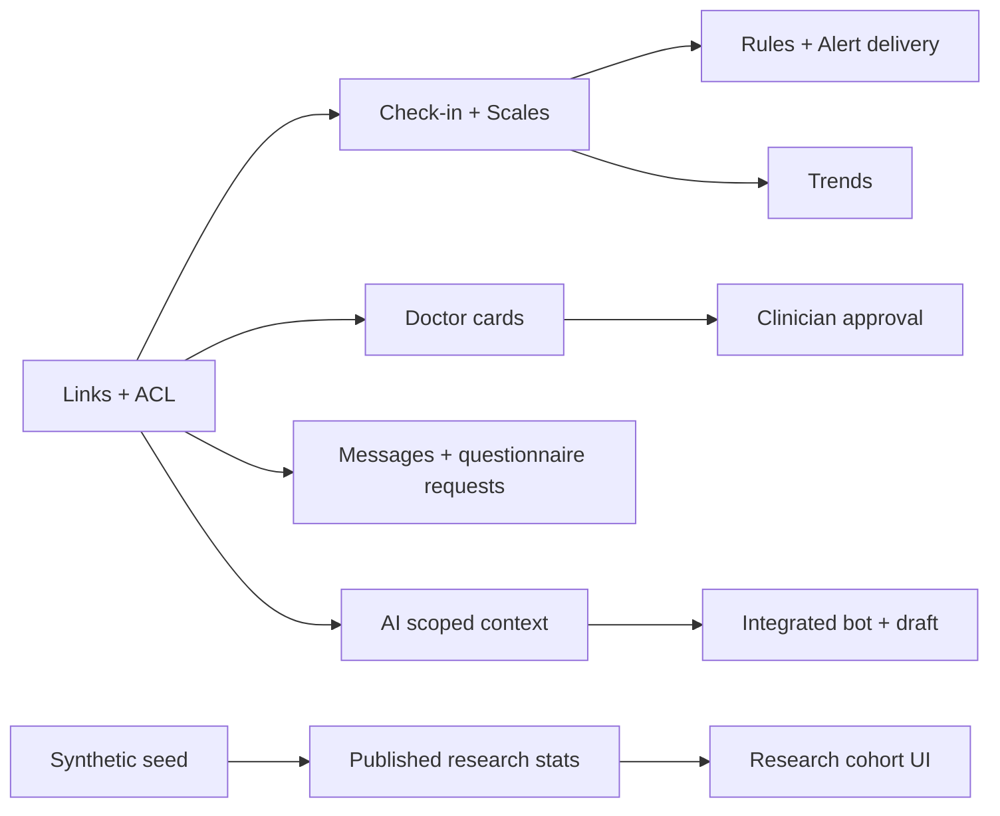

# 26. План 10 дней: распределение работ и критерии приёмки

**Дедлайн:** десять календарных дней от старта реализации (D1–D10, конкретную дату презентации команда уточняет). **Состав:** 5 человек, из них два разработчика, один tech/business lead, клинический эксперт, междисциплинарный специалист. Предполагается не более одной критической интеграционной ветки одновременно.

## 1. Владельцы

| Код | Роль | Ответственность |
|---|---|---|
| LEAD | Технический/product/business lead | ТЗ, архитектурные решения, приоритизация, интеграции, демо, дополнение кода по возможности |
| BE | Backend разработчик | Модели, ACL, seed, API, core tests, alerts, adapters |
| FE | Frontend разработчик | Flask/Jinja/JS, UX doctor/patient, researcher/clinic minimal, интеграция API |
| MED | Медицинский специалист | Источники, конкретные шкалы/переводы/правомерность использования, препараты, «Авиандр», клинические правила, проверка подсказок |
| BIO | Междисциплинарный специалист | Synthetic cases, QA клинических сценариев, аналитика/statistics, eval AI, резерв BE/FE |

## 2. Дневной план с gates

| День | BE | FE | LEAD / MED / BIO | Gate (доказательство) |
|---|---|---|---|---|
| D1 | app factory, models core, миграции | Layout design, shared components, демо маршруты | LEAD согласует P0; MED выбирает шкалу и источники; BIO seed specification | Flask запускается + seed schema + макеты экранов |
| D2 | Users/roles/links + permission policy | Doctor patient list и patient today на mock DTO | LEAD contract freeze v1; MED конкретные clinical prompts; BIO создаёт 4 синтетических пациента | Два врача получают разные DTO одного пациента |
| D3 | Check-in/observations API + questionnaire | Patient check-in, анкета, график | MED сверяет scoring; BIO negative ACL testing | Patient entry сохраняется и виден врачу |
| D4 | Prescriptions, self reports, appointments | Doctor patient detail: timeline/medications/visits | MED проверяет meds источники; BIO synthetic adherence | Терапия и дневные/ретро отчёты корректны |
| D5 | Alert/outbox + request/ack + referrals | Critical banner + appointment requests + doctor decisions | MED фиксирует clinical triggers и «Авиандр»; LEAD end-to-end QA | Кейс F1–F8 проверен минимум в одной цепочке |
| D6 | Messaging + questionnaire assignment and inbox | Doctor chat / pre-visit / patient notifications | MED/BIO проверяют клин flow; LEAD гоняет demo | Запрос формы → выполнение → врач получил |
| D7 | AI adapter, safety fallback, draft summary | Встроенный patient support bot + doctor AI draft review | BIO собирает synthetics и safety evals; LEAD guards | Бот и один summary end-to-end; kill switch работает |
| D8 | Stats SQLite dataset + whitelist cohort queries | Research cohort view and filters, Clinic admin lite | BIO генерация dataset и expected outcomes; MED review interpretations | Число когорты меняется при фильтре, экспорт aggregate |
| D9 | Refactor/performance/security tests | Responsive polish, empty/error/loading states | LEAD ведёт dry-run и баг-триаж; MED final content approval | pytest + отказ прав + docs/приёмо-сдаточный лист |
| D10 | Freeze migrations + backup/restore | Финальный UI freeze | LEAD репетиция демо/питч; MED/BIO экспертная проверка, скринкаст | Релиз demo_tag, тест-лог, ограничения в слайдах |

Это **желаемая последовательность**, а не гарантируемая скорость выполнения. Если интерфейсы/БД начинают расходиться, gate D2 обязывает зафиксировать общий JSON-контракт.

## 3. Приоритет, если сроки срываются

**Оставить любой ценой:** 2 роли и ACL; синтетические данные; шкала с валидной формулой/источником; self-report и динамика; врачебное подтверждение решения; НЯ/приверженность; сигналы маршрутизации; критический alert с audit; «Авиандр»; сообщение.

**Сжать, но связать с UI:** AI chat → локальный детерминированный сценарный адаптер с fallback; AI summary → один редактируемый draft на синтетике; research → один dataset и 2–3 фильтра; clinic → очередь приёмов и приглашение без биллинга.

**Перенести:** межврачебный полноценный чат, распознавание аудио, похожие случаи, сложный статистический matching, персональные видеосессии, мимика, голосовая эмоциометрика, push/real-time delivery integrations.

## 4. Зависимости

**Основной риск:** попытаться одновременно писать все 99 функциональных пунктов без завершённой end-to-end связи двух ролей.

## 5. Gate проверки перед питчем

Чек-лист `[ ]` → `[x]` команда заполняет по факту:

- [ ] `F1` шкала: корректный score, русская версия, источник/лицензия проверены MED.
- [ ] `F2` терапия: справка/сценарий «Авиандр» подтверждён MED.
- [ ] `F3` индивидуальные риски/НЯ: проверенная синтетика и врачебная оценка.
- [ ] `F4` динамика: минимум 2 реальные точки разных дат.
- [ ] `F5` пациентский интерфейс: можно сохранить результат.
- [ ] `F6` коммуникация пациент ↔ врач проходит через ACL.
- [ ] `F7` приверженность: план и наблюдение не перепутаны.
- [ ] `F8` маршрутизация к психиатру: обязательно/желательно + врач подтверждает.
- [ ] Критический алерт: created, delivery attempt, ack, human assessment.
- [ ] Пациент B не доступен врачу A при отсутствии связи.
- [ ] Психотерапевт не видит запрещённый препарат в DTO, графиках, сводке и сортировке.
- [ ] Чат-бот встроен в UI; его реальный adapter/mock статус обозначен.
- [ ] Summary — черновик, и только подтверждённая версия входит в клиническую историю.
- [ ] Research работает с отдельной synthetic SQLite и фильтры меняют N.
- [ ] Не было обработки данных реальных пациентов.
- [ ] В презентации есть roadmap audio/video/facial research + валидация и ограничения.

## 6. Командный ритм

15-минутная утренняя синхронизация: вчера / сегодня / блокеры; end-of-day demo gate. Все новые просьбы после D5 проходят через LEAD и либо заменяют равный по сложности backlog item, либо уходят в roadmap. Врачебные/клинические пороги утверждает MED, а не frontend/backend.
